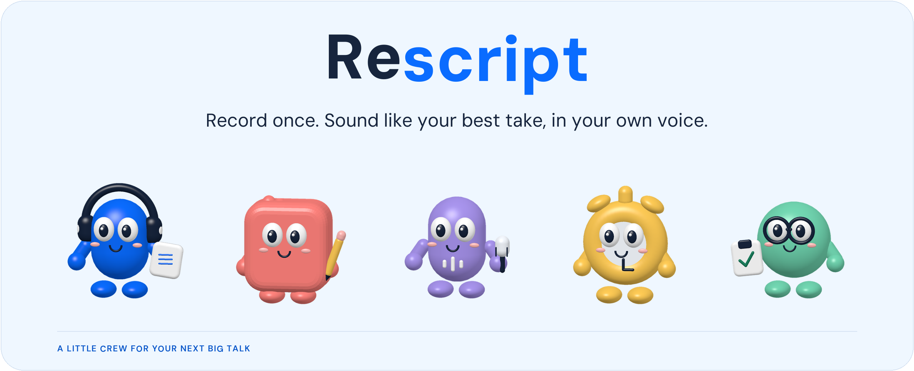
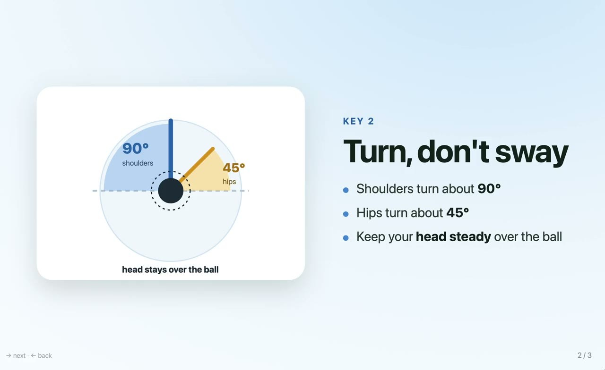
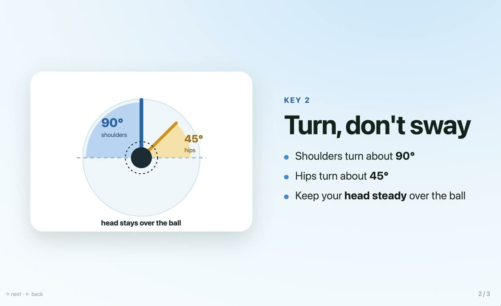

<p align="center">
  
</p>

<p align="center">Turns a rough screen recording of a talk or demo into a polished one, in your own voice, without re-recording.</p>

<p align="center">
  
  
</p>

[For judges](#for-judges) · [What it does](#what-it-does) · [See the difference](#see-the-difference) · [How it works](#how-it-works) · [Install](#install) · [Use](#use) · [Privacy](#privacy) · [Credits](#credits-and-licenses)

## For judges

- Demo video: [https://youtu.be/j_2JGosgkN4](https://youtu.be/j_2JGosgkN4) (2:56)
- Try it: follow [Install](#install), then record a minute of yourself talking through anything on screen
  (QuickTime → File → New Screen Recording, microphone on) and drop it into Rescript Studio (`bin/rescript app`).
- See a full run without installing: [docs/sample-run.md](docs/sample-run.md) has the golf talk's script, what was
  said, the stats and the checks.
- How it is built: [docs/how-it-works.md](docs/how-it-works.md) explains the flow, what runs on the Mac, and why.

## What it does

Rescript transcribes your recording, rewrites the narration into a clean script with the same facts, speaks it in a local clone of your voice, and retimes the video to fit.

| A rough recording | A clearer talk |
| --- | --- |
| Ums,&nbsp;long&nbsp;pauses,&nbsp;repeats,&nbsp;and&nbsp;false&nbsp;starts | A clean script with the same facts |
| Room&nbsp;echo | A cleaned voice sample |
| A&nbsp;recording&nbsp;that&nbsp;needs&nbsp;another&nbsp;take | Narration in your own voice, the video re-cut to the words |

Recordings stay on your Mac. GPT, through the Codex CLI on your own ChatGPT account, gets only text and a few still frames.

## See the difference

Lucas recorded his driver-swing tips in one rough take, and Rescript polished it.

| Before: his one rough take (1:33) | After: polished by Rescript (0:36) |
| --- | --- |
| [](https://youtu.be/j_2JGosgkN4?t=40) | [](https://youtu.be/j_2JGosgkN4?t=46) |

> "you um you know like you like you want to make sure that both of like…" became "I make sure my shoulder and hip turns match up so I stay connected during the swing."

## How it works

The six steps, what runs on the Mac, what each GPT call receives, and why it is built this way: [How Rescript works](docs/how-it-works.md).

## Install

Needs a Mac with Apple Silicon, Python 3.10 or newer, ffmpeg, and a ChatGPT account with Codex access. The first run
downloads the speech models (several GB).

### 1. Tools

With [Homebrew](https://brew.sh):

```bash
brew install python@3.12 ffmpeg node
```

### 2. Sign in to Codex with your ChatGPT account

Rescript sends the rewrite step to GPT through the official [Codex CLI](https://github.com/openai/codex):

```bash
npm install -g @openai/codex
codex login                       # choose "Sign in with ChatGPT"
codex login status                # should say: Logged in using ChatGPT
```

This uses your account's Codex allowance; no OpenAI API key is needed.

### 3. Rescript

```bash
git clone https://github.com/lucasw9999/Rescript-CAC2026.git
cd Rescript-CAC2026
python3.12 -m venv .venv && source .venv/bin/activate
python3 -m pip install -r requirements.txt
bin/rescript doctor               # checks the Mac, Python, ffmpeg, the packages and the Codex sign-in
```

Next, [start Rescript Studio](#start-rescript-studio).

Optionally put the command on your `PATH`: `mkdir -p ~/.local/bin && ln -s "$PWD/bin/rescript" ~/.local/bin/rescript`.

## Use

### Start Rescript Studio

In the `Rescript-CAC2026` folder, with the virtual environment active (in a new Terminal window, run
`source .venv/bin/activate` first):

```bash
bin/rescript app                  # starts Rescript Studio and opens it in your browser
```

Drop a screen recording onto the window and watch each step run. When it's done, the original and the polished
video play side by side, with the script underneath: click a line to hear it, edit it, or ask for a change, and only
that line is redone. Press Control-C in the Terminal to stop it. What each screen shows:
[docs/studio.md](docs/studio.md).

To start it with a double-click instead, run `app/make_mac_app.sh` once. It puts "Rescript Studio.app" in
`~/Applications`.

### From the terminal

```bash
bin/rescript polish ~/Desktop/demo.mov                   # writes "demo - polished.mp4" next to it
bin/rescript fix ~/Desktop/demo.mov 2:14 "say the product name more clearly"
bin/rescript fix ~/Desktop/demo.mov 2:14                 # just re-speak that line
bin/rescript save-voice ~/Desktop/demo.mov me            # later: bin/rescript polish other.mov --voice me
```

Speak for at least a minute so there is a smooth 10-18 second stretch for the voice sample. `polish` keeps its work
in `/tmp/polish-<name>/` and skips finished steps on a rerun; `--rewrite` asks for a new script, `--fresh` starts
over. The model defaults to `gpt-6.1-sol` with high reasoning (`--model`, `--effort` to change). The rewriting rules
are in `rules/script-rules.md`.

## Privacy

Transcription, voice cleanup, voice synthesis, and video rendering run locally. Only text (the transcript, the
rewriting rules, change requests and the lines the voice check flagged) and a few still frames go to GPT through
Codex. Rescript never sends the audio, your voice sample, or the full
video. `--no-check` skips the final GPT frame check; the rewrite still goes to GPT.

Keep your Codex sign-in in Codex's own storage, outside this folder, and never commit login files or keys. Saved
voices and recordings are personal data; the repository ignores them.

## Credits and licenses

Rescript's own code is in this repository. It builds on these models and libraries, used under their licenses:

| Used for | Project | License |
|---|---|---|
| Transcription | [Whisper large-v3-turbo](https://huggingface.co/openai/whisper-large-v3-turbo) (OpenAI), run with [mlx-whisper](https://github.com/ml-explore/mlx-examples) | MIT |
| Voice&nbsp;cloning | [Qwen3-TTS 1.7B Base](https://huggingface.co/Qwen/Qwen3-TTS-12Hz-1.7B-Base) (Qwen), run with [mlx-audio](https://github.com/Blaizzy/mlx-audio) | Apache-2.0 |
| Echo&nbsp;and&nbsp;noise&nbsp;removal | [Sidon](https://huggingface.co/soniqo/Sidon-ONNX) with [w2v-BERT 2.0](https://huggingface.co/facebook/w2v-bert-2.0) features, run with [ONNX Runtime](https://onnxruntime.ai) | MIT |
| Running&nbsp;models&nbsp;on&nbsp;Apple&nbsp;silicon | [MLX](https://github.com/ml-explore/mlx) (Apple) | MIT |
| Video | [FFmpeg](https://ffmpeg.org), [OpenCV](https://opencv.org) | LGPL/GPL<br>Apache-2.0 |
| Rewriting&nbsp;the&nbsp;script | GPT through the [Codex CLI](https://github.com/openai/codex), on your ChatGPT account | OpenAI&nbsp;terms |
| App | [three.js](https://threejs.org), DM Sans and Fredoka fonts (in `app/assets`) | MIT, OFL |

Clone only your own voice, and tell your audience the narration is AI-generated.

---

Made by Lucas Wu for the 2026 Congressional App Challenge.
