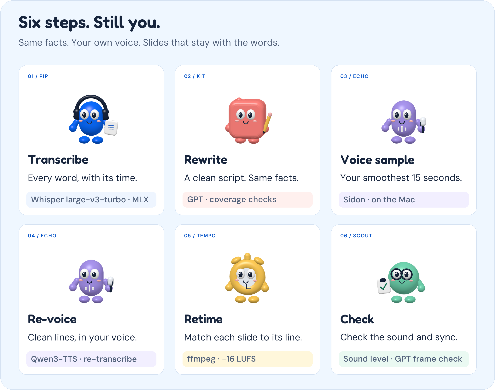
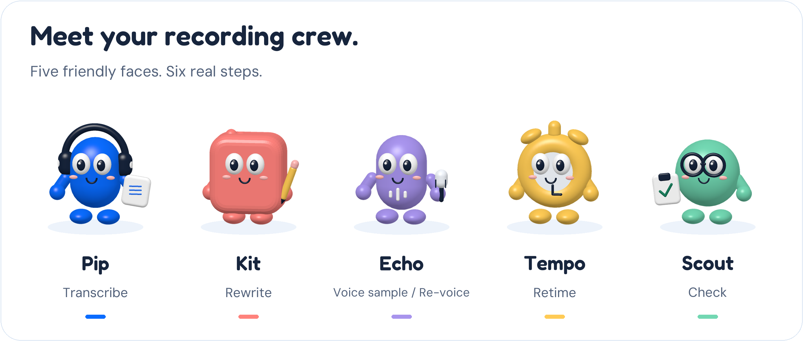

# How Rescript works

Rescript turns one rough screen recording into a polished video. The speech, voice and video work runs on the Mac;
GPT, in the cloud, gets only text and a few still frames.

Meet Pip, Kit, Echo, Tempo, and Scout

The recording crew illustrates the pipeline. Echo covers both Voice sample and Re-voice, so five characters explain the six steps.

## The flow

| Step | What happens | Code | Runs on |
|---|---|---|---|
| 1.&nbsp;Transcribe | Lines up a late microphone track with the picture, writes down every word with its start and end time, saves a frame every 20 seconds, and finds smooth 10-18 second stretches of speech. | `scripts/prepare.py` | Mac:&nbsp;Whisper&nbsp;large&#8209;v3&#8209;turbo&nbsp;on&nbsp;MLX |
| 2.&nbsp;Rewrite | GPT turns the transcript, the rules, up to 12 slide frames and the last frame into a clean script. Code checks that it covers every transcript word once, in order, and sends any problems back (up to 3 tries). | `bin/rescript` `rules/script-rules.md` | Cloud:&nbsp;GPT&nbsp;through&nbsp;the&nbsp;Codex&nbsp;CLI |
| 3.&nbsp;Voice&nbsp;sample | Cuts a smooth 10-18 second stretch of the speaker and removes echo and room noise. | `scripts/restore_ref.py` | Mac:&nbsp;Sidon&nbsp;on&nbsp;ONNX&nbsp;Runtime |
| 4.&nbsp;Speak&nbsp;and&nbsp;check | The voice clone reads each line, and every line is transcribed back. A line under 90% match is flagged, GPT rewords only the real mistakes, and only those lines are spoken again. | `scripts/tts.py` `bin/rescript` | Mac:&nbsp;Qwen3&#8209;TTS&nbsp;on&nbsp;MLX,&nbsp;Whisper Cloud:&nbsp;GPT&nbsp;for&nbsp;the&nbsp;rewording |
| 5.&nbsp;Retime | Each line keeps the video it was about, sped up or slowed to fit. The video is first converted to a steady 30 frames per second. Loudness is set to -16 LUFS, with a warning above a 3x speed-up. | `scripts/render.py` | Mac:&nbsp;ffmpeg |
| 6.&nbsp;Check | Measures loudness, then asks GPT whether the screen fits the words, using one frame from 4 lines (first, a third in, two thirds in, last). | `bin/rescript` | Mac:&nbsp;ffmpeg&nbsp;for&nbsp;loudness Cloud:&nbsp;GPT&nbsp;for&nbsp;the&nbsp;frames |

Rescript Studio (`app/server.py`, `app/studio.js`) runs the same steps through the same command and shows them live.
Fixing one line speaks only that line again; the video is then rendered again from the saved work, reusing
everything else.

## What leaves the Mac

Only text and a few still frames: the transcript, the rewriting rules, change requests, the lines the voice check
flagged with what was heard back, up to 12 slide frames plus the last frame for the rewrite, and 4 frames with their lines for the final check.
Rescript never sends the audio, the voice sample, or the full video.

### What each GPT call receives

Each call is a separate, non-interactive `codex exec --ephemeral` run with no memory of earlier calls.

- Script writing: the rules from `rules/script-rules.md`, the transcript with word numbers and pause markers,
  the sampled frames, and the required JSON format. If the result doesn't cover the transcript correctly, the errors
  and the previous answer are sent back for correction.
- Speech correction: the intended lines and what was heard back, so GPT can tell a pronunciation problem from a
  harmless formatting difference.
- Fixing a line: your instruction, what was originally said for that line, the current line, and its neighbours.
- Final check: the 4 frames and the narration for those lines.

## Why it is built this way

- Rewrite and re-voice instead of cutting out mistakes. Cutting ums out of the real audio leaves the broken
  sentences, the hedges and the echo. Rewriting the words and saying them again in the same voice, from a cleaned voice sample, fixes all three.
- Checks on the AI steps that can fail silently. A language model can skip a sentence and a voice clone can drop
  a word, and both are easy to miss by ear. So the code checks that the script covers the whole transcript, and it
  transcribes every spoken line back.
- A steady 30 frames per second before cutting. Screen recordings save a new frame only when something changes,
  so a still slide can go seconds without a new frame. Cuts landed on the next saved frame, a little late, and on
  a twelve-minute talk that added up to seven seconds. Converting first fixed it.
- Speech models on the Mac. Recordings are personal, so transcription, voice cleanup, voice cloning and video
  editing run locally. Only the language-model steps (the rewrite, changing a line on request, rewording flagged lines, and the frame check) use
  the cloud, and they get text and still frames.
- Fix one line, keep the rest. Each step saves its results in `/tmp/polish-<name>/`, so a rerun skips finished
  steps and fixing one line only re-speaks that line.
- Cursor eraser. The macOS pointer is pure black with a white rim, so `scripts/cursor_detect.py` looks for small
  pure-black shapes and uses OpenCV to score each one against cursor-shaped templates, and `scripts/cursor_erase.py`
  covers it with the same spot from a nearby frame where it isn't.

## Known limits

- Mac with Apple Silicon only: transcription and voice cloning run on Apple's MLX. Windows support is planned.
- Needs a ChatGPT account with Codex access for the rewrite.
- A long silent stretch gets sped up a lot to fit its line; Rescript warns above 3 times.
- One voice per video: a talk with several speakers is cloned as one voice.

## Code map

- `bin/rescript`: the command (polish, fix, save-voice, app, doctor), the rewrite step and the checks.
- `scripts/`: one file per step (`prepare.py`, `restore_ref.py`, `tts.py`, `render.py`), the cursor eraser
  (`cursor_detect.py`, `cursor_erase.py`, with `cursor_templates_macos_retina.npz`) and the setup check
  (`check_setup.py`).
- `app/`: Rescript Studio, a local web app on 127.0.0.1 only.
- `rules/script-rules.md`: the rules the rewrite follows.
