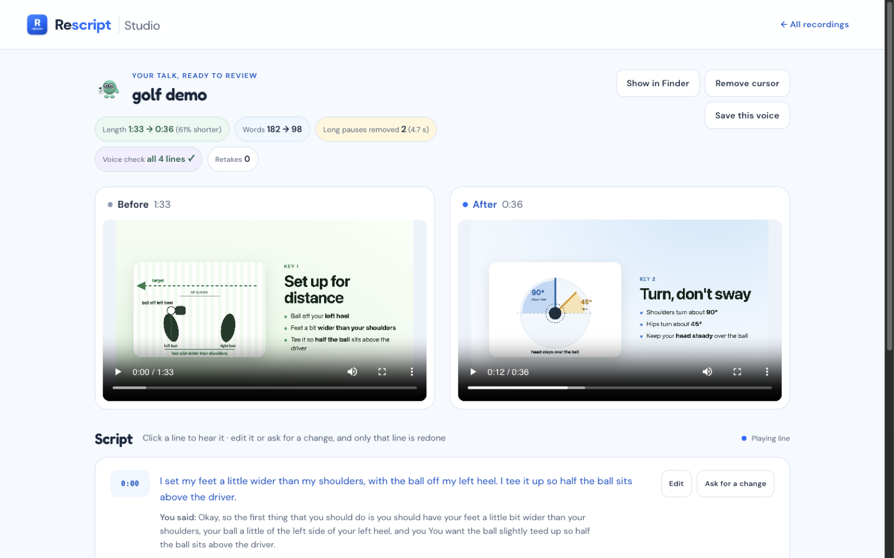
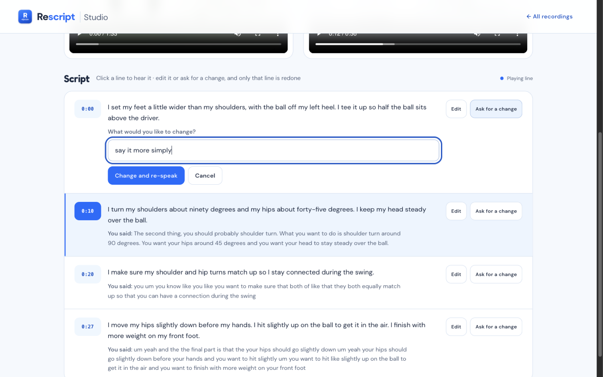

# A sample run: the golf talk

This is the run shown in the demo video: Lucas's one-take, 1:33 screen recording of his driver-swing tips.
You can see what Rescript produced without installing anything. Two short clips of the recording play in the
[demo video](https://youtu.be/j_2JGosgkN4?t=32).

## The result

| | Before | After |
|---|---|---|
| Length | 1:33 | 0:36 (61% shorter) |
| Words | 182 | 98 |
| Long pauses | 2 (4.7 s) | removed |
| Voice check | | all 4 lines passed |
| Retakes | | 0 |

  

## The script, line by line

Each line is what Rescript wrote, with what was said in the original recording underneath. The times are where the
line starts in the original.

**1 (0:03).** I set my feet a little wider than my shoulders, with the ball off my left heel. I tee it up so half the
ball sits above the driver.

> Said: Okay, so the first thing that you should do is you should have your feet a little bit wider than your
> shoulders, your ball a little of the left side of your left heel, and you You want the ball slightly teed up so half
> the ball sits above the driver.

**2 (0:35).** I turn my shoulders about ninety degrees and my hips about forty-five degrees. I keep my head steady
over the ball.

> Said: The second thing, you should probably shoulder turn. What you want to do is shoulder turn around 90 degrees.
> You want your hips around 45 degrees and you want your head to stay steady over the ball.

**3 (0:53).** I make sure my shoulder and hip turns match up so I stay connected during the swing.

> Said: you um you know like you like you want to make sure that both of like that they both equally match up so that
> you can have a connection during the swing

**4 (1:09).** I lower my hips slightly before moving my hands. I hit slightly up on the ball to get it in the air. I
finish with more weight on my front foot.

> Said: um yeah and the the final part is that the your hips should go slightly down um yeah your hips should go
> slightly down before your hands and you want to hit slightly um you want to hit like slightly up on the ball to get
> it in the air and you want to finish with more weight on your front foot

## The checks

- Coverage: the four lines cover all 182 transcript words once, in order (words 0-50, 51-87, 88-119 and 120-181).
- Voice: every spoken line was transcribed back and compared with the script. "90" and "ninety" count as the same.
- Line 4 was later changed with Ask for a change and spoken again on its own. Transcribed back, the new line matched
  the script word for word; lines 1 to 3 kept their audio.

  

